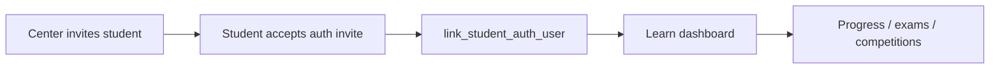

# Journey: Student learn portal

Enrolled students use `http://learn.{brand}.localhost:9000/` after center invite and auth link.

## Flow

## Steps

1. Center staff open Students → Portal access, set **Login email** + **Password**, and **Activate portal login** (or **Update portal login** to reset). This calls Edge Function `student-portal-credentials` + `sync_student_portal_credentials` (Auth user + `students.user_id` / `login_email`). The password is shown once so staff can share it. Deploy the function after migration `115_student_portal_credentials.sql`.
2. Learn host must resolve `brandId` (`resolveTenantScope` + `get_portal_branding`, or `learn.{brand}.localhost` in `domain_mappings`). Without `brandId`, Home is blank.
3. Student authenticates on the learn host with that email/password; `/login` shows the franchise public header and footer when Student Login (or Copy Profile URL) included `?center=` (or the visitor came from the franchise site). If `user_id` was not linked yet, `resolve_student_for_learn` auto-links when Auth email matches `login_email`.
4. Learn RPCs require an **active** center enrollment under the brand; otherwise UI shows contact-center guidance (`NO_ACTIVE_ENROLLMENT`).
5. Pinned course (`pin_enrollment_program`) appears on Progress via `get_student_program_ladders`. Dashboard shows enrollment-scoped progress, assessments, and competitions (FR-S10+).
6. Profile **Center website** must not use raw RPC `center.public_url` (`http://*.localhost:9000/` from `domain_mappings`). Client rewrites with `resolveCenterWebsiteUrl` so Vercel opens `/?portal=center&brand=…&center=…`.

## Success criteria

- No learn data without active enrollment.
- Records scoped to `enrollment_id` / `center_id` / `brand_id`.
- Auth link unique per brand.

## Related

- OpenSpec: [`student-learn-portal`](../../openspec/specs/student-learn-portal/spec.md)
- [Navigation spec](../spec/navigation-spec.md)
- [Test users](../ops/test-users.md)
- [Data flow](../spec/data-flow.md) Flow 8
